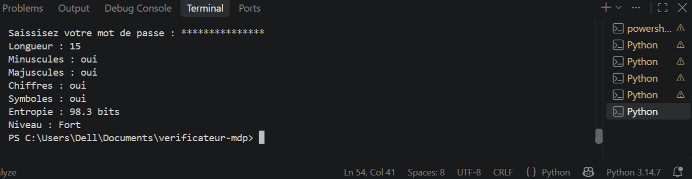

# Vérificateur de mots de passe
Ce programme permet d'évaluer la robustesse d'un mot de passe choisi par l'utilisateur et de lui proposer des conseils pour l'amélioer s'il est jugé trop faible

## Fonctionnalités
- calcule l'entropie du mot de passe en bits
- masque la saisie du mot de passe avec des étoiles
- évalue le niveau de sécurité du mot de passe 
- fournit des conseils à l'utilisateur pour améliorer son mot de passe
- exécute des tests sur les quatres fonctions afin de vérifier leur bon fonctionnement et d'éviter les erreurs

## Installations

- git clone https://github.com/Steeve-B78/verificateur-mdp.git
- cd verificateur-mdp
- python -m pip install pwinput pytest

## Utilisation
- Lancez le programme avec la commande : python verificateur.py
- Saisissez ensuite le votre mot de passe lorsque le programme vous le demande

Voici un aperçu de ce qu'affiche le code 

## Comment ça marche

L'entropie du mot de passe est calculée en bits.

- En dessous de 40 bits : le mot de passe est considéré comme faible
- Entre 40 et 60 bits : le mot de passe est considéré comme moyen
- Au dessus de 60 bits : le mot de passe est considéré comme fort

Le programme fournit également des conseils pour aider l'utilisateur à améliorer son mot de passe

## Ce que j'ai appris

Durant la conception de ce programme j'ai appris plusieurs notions, notamment le calcule de l'entropie d'un mot de passe, la sauvegarde de mon travail sur GitHub avec Git dans le terminal et la réalisation de tests pour vérifier le bon fonctionnement du programme.

j'ai également découvert comment organiser un projet Python et rédiger sa documentation